# Raport: druga runda

Gałąź **`feat/cinematic`**: 9 commitów rundy 2 (`bdfe6b6` plan, potem `9d07dac`…`5cd78b9`), **niepushowana**.
Plan: [PLAN-2.md](PLAN-2.md), research: [inspiration.md](inspiration.md) (sekcja „Runda 2”), każda generacja:
[media-log-2.md](media-log-2.md), zrzuty: [shots-2/](shots-2/).

## Kredyty

| | Kredyty |
| --- | --- |
| Saldo na starcie rundy (`account status`) | 2427,5 |
| Pula „Concurrent Boost” z upgrade'u (osobna, niewidoczna w `status`) | 200 |
| Próg (hook `HF_CREDIT_FLOOR=1500`) | 1500 |
| Wydane z puli boost (zadania #1–#23) | 183,5 |
| Wydane z salda głównego (zadania #24–#44) | **130,25** |
| **Saldo końcowe** | **2297,25** |
| Zapas nad progiem | 797,25 |

Na całą rundę planowałem ~610 kredytów, a zeszło 130 z salda (plus 183,5 z puli boost, która i tak by
przepadła). Kosztów nie podbił Seedance, bo tańszy Kling O3 (pierwsza i ostatnia klatka, 6,25–12,5 za
klip) okazał się na tyle wierny, że zastąpił go także w ujęciach z ruchem kamery. Hook zapisał każde
zadanie jako `allow` z progiem 1500. Jedno zadanie (#23→#25) odrzucił serwis, gdy skończyła się pula boost.

**Pula boost:** `higgsfield account transactions` pokazuje, że upgrade dał 200 kredytów „Concurrent Boost”
i dopiero po ich zużyciu zadania zaczęły schodzić z salda głównego. Do zapamiętania przy następnych
upgrade'ach.

## Co zrobione

Każdy efekt ma przełącznik w `UI/store-app.UI/src/lib/motion.ts`, a przy reduced motion wszystkie zostają
statyczne. Wszystkie filmy kończą się na prawdziwym zdjęciu sklepu albo nie ma w nich żadnego towaru
(pusty pokój, materiał, paczka, las).

### A. Bez kredytów: układ, tekst, interakcje (`9d07dac`)

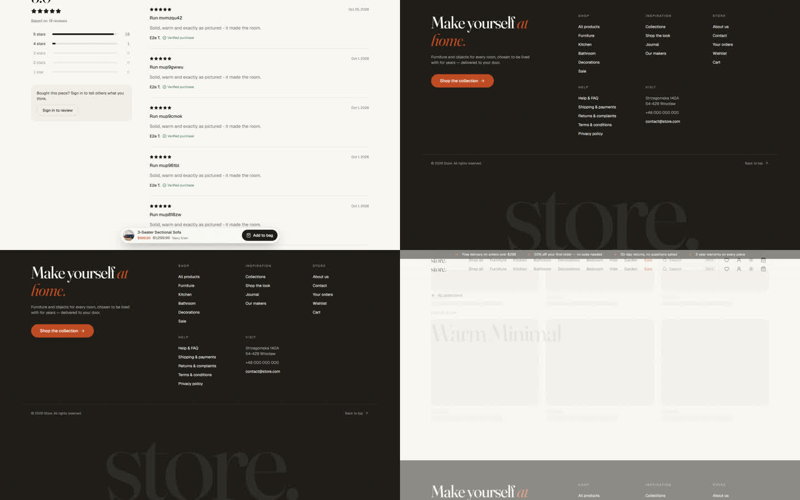

- **Przyklejony pasek zakupu:** miniatura, wykończenie, cena i „Add to bag” na dole ekranu, gdy główny
  przycisk zniknie. Na telefonie siedzi nad dokiem i chowa się przy stopce.
- **„You may also like”:** na telefonie dwie kolumny.
- **Artykuł jak strona książki:** inicjał w kolorze terakoty, większy tekst, linia postępu czytania i duża
  okładka „Read next” na końcu.
- **Stopka na telefonie:** grupy linków zwinięte w przyciski (wcześniej stopka miała ponad ekran).
- **Detale:** serce ulubionych wypełnia się od dołu, a 404 przestało przepraszać.
- **Przejścia okładek:** okładka kolekcji, lookbooka, twórcy i artykułu przechodzi w nagłówek strony,
  tak jak zdjęcia produktów (`src/lib/viewTransition.ts`).

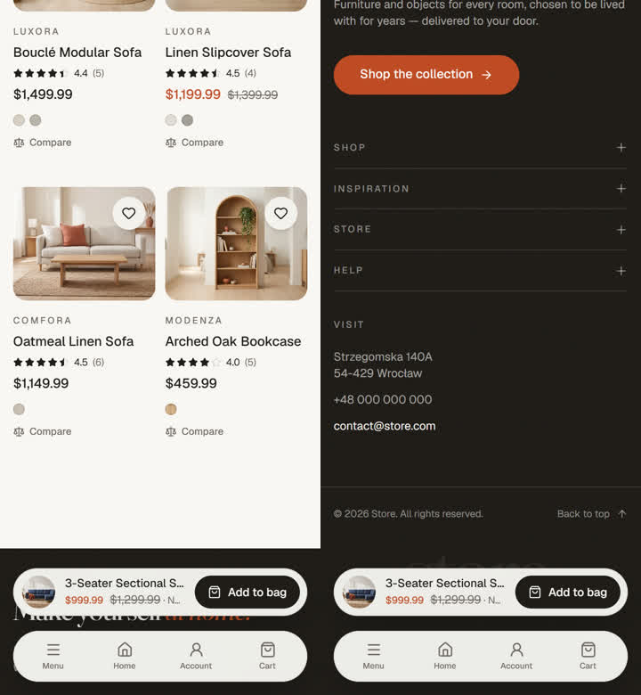 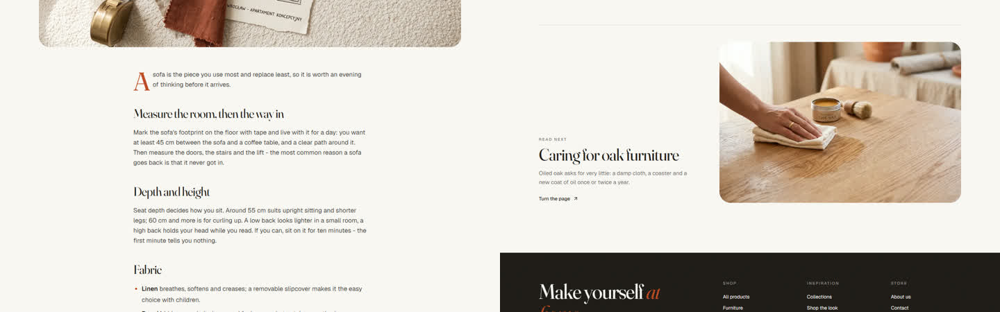

### B. 404 i puste stany (`acc94a5`, `emptyRoom`)

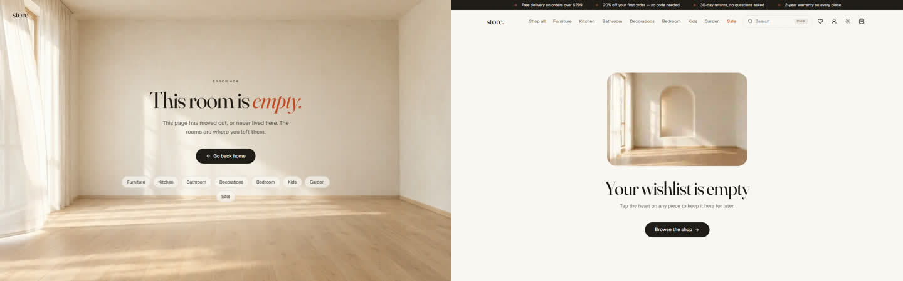

- **404:** pusty, nieurządzony pokój z firanką i światłem w ruchu (pętla 10 s) oraz linki do wszystkich
  pokoi sklepu.
- **Puste stany:** pusty koszyk, ulubione i porównanie dostały po jednym spokojnym kadrze pustej przestrzeni
  zamiast ikony.
- **Nowy wspólny komponent:** `AmbientLoop`, czyli zdjęcie, które ożywa pętlą, gdy zbliża się do ekranu, i
  pauzuje poza nim.

### C. Wieczór w ciemnym motywie (`e1fd5bc`, `eveningHero`)

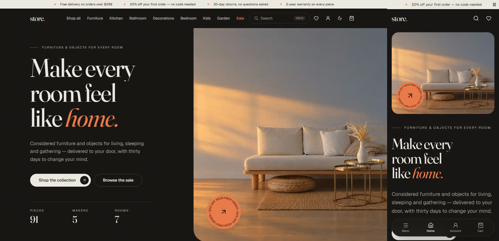

- **Wieczorne hero:** w ciemnym motywie strona główna pokazuje ten sam salon o zachodzie słońca
  (bursztynowy pas światła na ścianie, pętla 10 s), a w jasnym motywie zostaje poranek.
- **Poprawka WebP:** przy okazji przekodowałem wszystkie plakaty z obu rund. ffmpeg ignorował `-quality`
  w libwebp, przez co miały 3–10 kB i były rozmyte.

### D. Wejścia do wszystkich lookbooków (`b5d499c`)

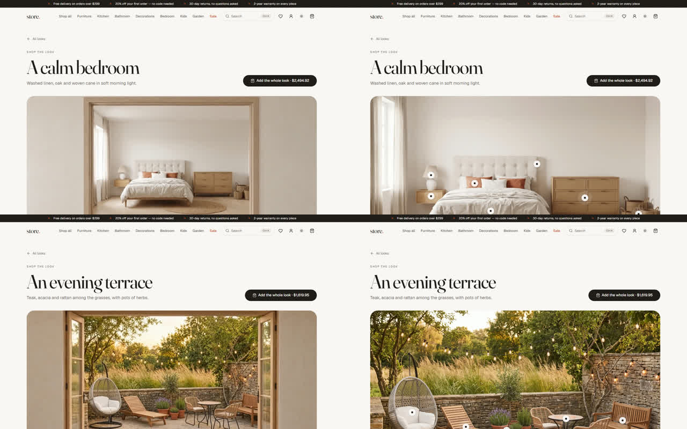

- **Nowe wejścia:** sypialnia, kuchnia i pokój dziecka (z korytarza, przez dębową futrynę) oraz ogród (z
  domu, przez szklane drzwi na taras).
- **Jak gra:** na stronie lookbooka film gra raz po wejściu i zostawia zdjęcie z punktami produktów.
  `ScrollFilm` ma do tego tryb `trigger="arrival"`, raz na kartę przeglądarki.

### E–F. Kolekcje o swojej porze dnia, warsztaty twórców (`3f7aa9f`, `coverLoops`)

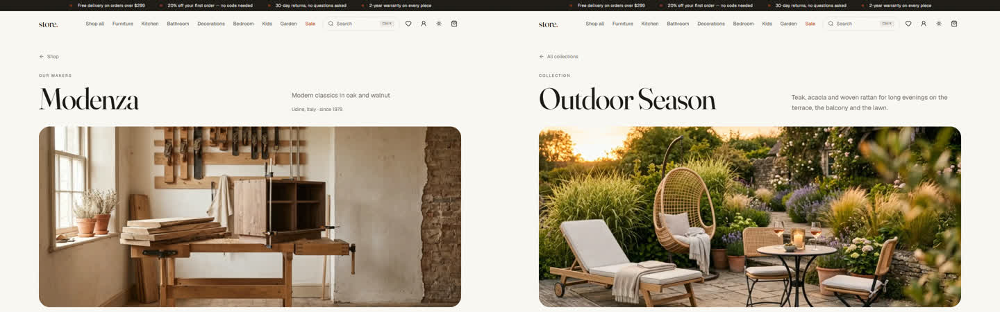

- **Kolekcje:** Warm Minimal to poranek, Small Spaces południe, Outdoor Season zachód z trawami w wietrze.
- **Twórcy:** każdy z 5 warsztatów ma pył w smudze okiennego światła.
- **Zmiana planu:** zamiast kolumny kilku klipów na twórcę jest jedna pętla w okładce. Klimat ten sam, przy
  ułamku mediów.

### G. Nowa zakładka „Materiały” (`9231ff8`, `materialLoops`)

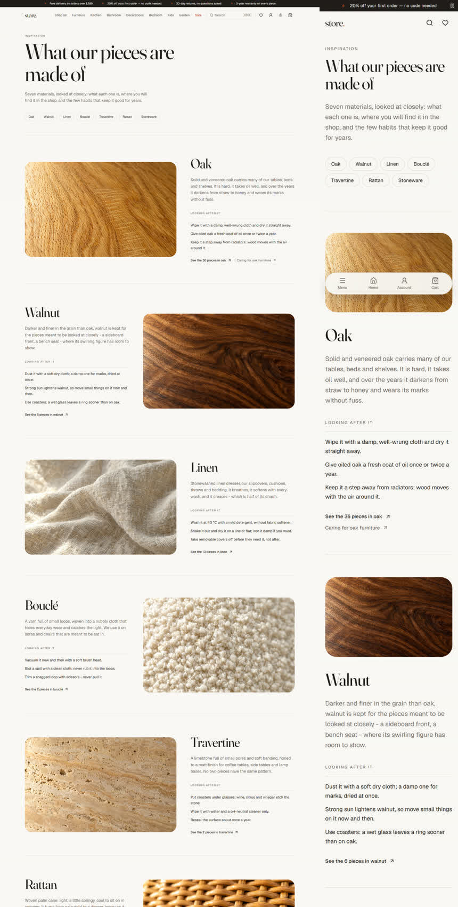

- **Strona `/materials`** (menu Inspiration i sitemap): dąb, orzech, len, bouclé, trawertyn, rattan,
  kamionka.
- **Każdy materiał:** makro w ruchomym świetle, opis, trzy nawyki pielęgnacji i link do produktów z
  liczbą sztuk.
- **Strona produktu:** w specyfikacji linkuje do odpowiednich materiałów („How to look after oak”).

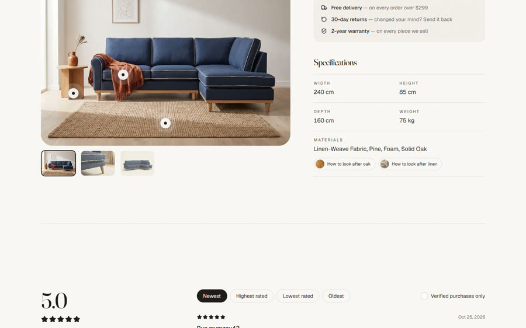

### H. Pilot 3D: niepublikowany

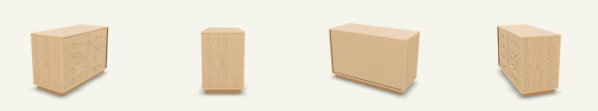

- **Model:** Tripo z pakshotu komody, 18 kr. Bryła wierna (8 szuflad, mosiężne uchwyty), a tył i boki
  dorysowane.
- **Dlaczego nie opublikowałem:**
  1. Plik waży 68 MB.
  2. Potrzebna jest biblioteka 3D (~250 kB).
  3. Tekstury GLB wymagają `blob:` w CSP nginx, a infrastruktury zgodnie z briefem nie ruszam.
- **Decyzja należy do Ciebie.** Do wdrożenia trzeba: `gltf-transform` (zmniejszenie tekstur do 1024 i
  kwantyzacja), `@google/model-viewer` ładowany po kliknięciu i `blob:` w `img-src`/`connect-src`.

### I. Paczka po zapłacie (`92b06a5`, `orderParcel`)

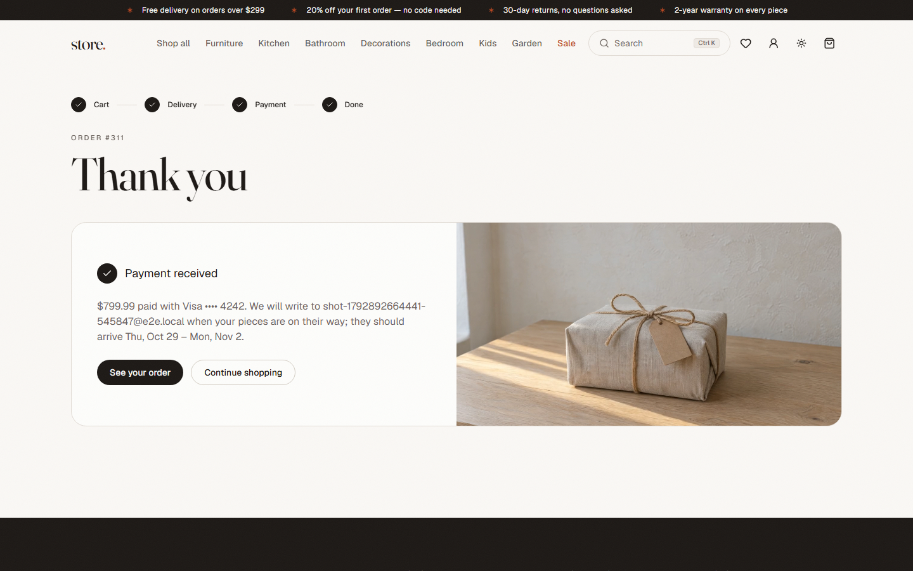

Strona „Thank you” obok potwierdzenia płatności pokazuje paczkę w lnie z jutowym sznurkiem. Poranne słońce
dochodzi do niej raz i zostaje na ciepłej ostatniej klatce. To domknięcie historii z filmu na logowaniu.

### J. „From the forest to your room” na stronie O nas (`5cd78b9`, `aboutJourney`)

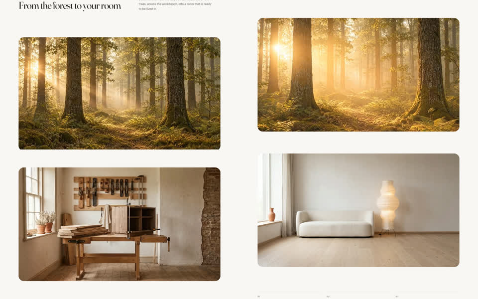

- **Film:** 20 s przewijane scrollem, z obrazem przypiętym na środku ekranu przez 2 wysokości scrolla.
  Prowadzi z dębowego lasu o świcie, przez złotą poświatę, do warsztatu i dalej do gotowego pokoju.
- **Jak powstał:** dwa klipy Kling sklejone na dokładnie ostatniej klatce pierwszego, z końcem na
  prawdziwym zdjęciu kolekcji. Pod filmem są trzy kroki (las, warsztat, pokój).
- **Ograniczenie:** przejścia między las–warsztat i warsztat–pokój są przenikaniem przez światło, a nie
  ciągłym ruchem. W scrollu czytają się jak rozdziały.

### Android

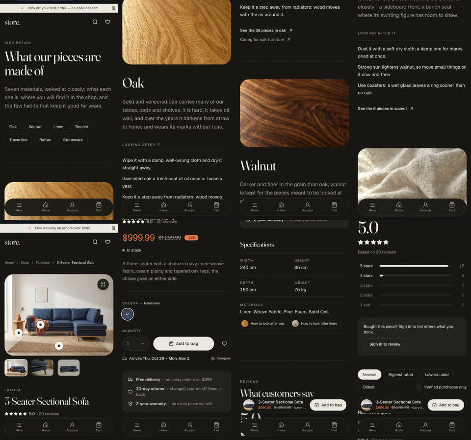

Na Pixelu (Chrome, motyw ciemny) sprawdziłem: Materiały, stronę produktu z paskiem zakupu i linkami do
materiałów oraz 404 (w ciemnym motywie nastrojowo przyciemnione, tekst czytelny).

## Jak wyłączyć

| Efekt | Przełącznik (`src/lib/motion.ts`) |
| --- | --- |
| 404: pusty pokój w ruchu | `emptyRoom` |
| Wieczorne hero w ciemnym motywie | `eveningHero` |
| Wejścia do lookbooków (strona główna i strony lookbooków) | `lookbookEntrance` |
| Pętle w okładkach kolekcji i twórców | `coverLoops` |
| Pętle materiałów | `materialLoops` |
| Paczka po zapłacie | `orderParcel` |
| Film na stronie O nas | `aboutJourney` |

Zmiany układu i tekstu (pasek zakupu, artykuł, stopka, puste stany, strona Materiały, linki w specyfikacji)
nie mają przełączników. Cofnięcie robi się przez `git revert` danego commita.

## Kontrole

| Kontrola | Wynik |
| --- | --- |
| `npm run lint` | czysto |
| `npm test` | 192/192 (nowe testy: AmbientLoop, HeroLight wieczorem, ScrollFilm „arrival”, materialsIn) |
| `npm run build` / `check:bundle` | OK, bundle główny 428 z 500 kB (było 423) |
| e2e (stos Docker) | 28/28: wszystko na serwerze Vite, SEO (sitemapy z nową `/materials`) na przebudowanym kontenerze `ui`; test 12 (kod rabatowy) przekroczył czas przy pełnym przebiegu, przy powtórce zielony (jak test 17 w rundzie 1: wyścig po długim przebiegu) |
| `npm run test:visual` | 40/40, **bez aktualizacji snapshotów** |
| Lighthouse (docker, 5 stron, mediana z 3) | wszystkie asercje zaliczone: perf 0,98–0,99, LCP 0,96–1,11 s, CLS 0, TBT ≤ 18 ms; łącznie `/` 825 KB, `/products` 664, produkt 902 (było 674: miniatura paska zakupu i zdjęcia przy materiałach), journal 790, `/about` 786 KB (z limitu 1,5 MB) |

## Uwagi i co dalej

- **Do decyzji: 3D (H)** razem z CSP, patrz wyżej.
- **Do decyzji: A7 (odcień pory dnia wg zegara):** pominięte. Ciemny motyw z wieczornym hero spełnia już
  tę rolę, a dwa systemy pory dnia by się gryzły.
- **Lokalna baza:** recenzje z danymi e2e („Run mup…”) widać na stronach produktów.
- **Nieskomitowane, celowo:** `BRIEF.md`, `image-prompts.md`, `.claude/` (w tym `settings.local.json` z
  progiem 1500 i `launch.json`) oraz surowe media w `UI/store-app.UI/media-work/`.
- **Pomysły na kolejną rundę (zapas ~797 kr nad progiem):**
  1. Pętle światła na zdjęciach głównych kategorii (kafle „Shop by room”), ok. 8 × 12,5.
  2. Wieczorne wersje okładek kolekcji dla ciemnego motywu.
  3. Wdrożenie 3D, jeśli zgodzisz się na zmianę CSP.
