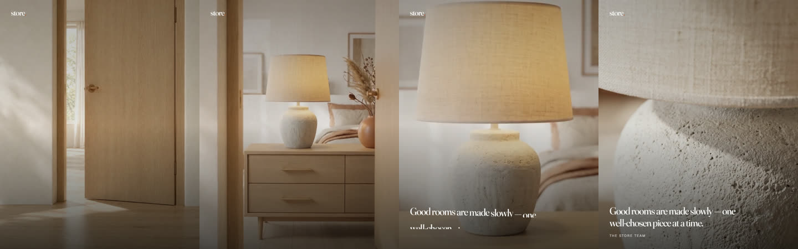
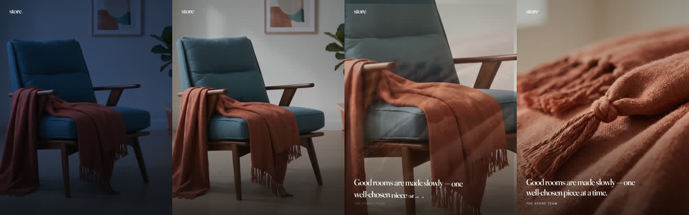
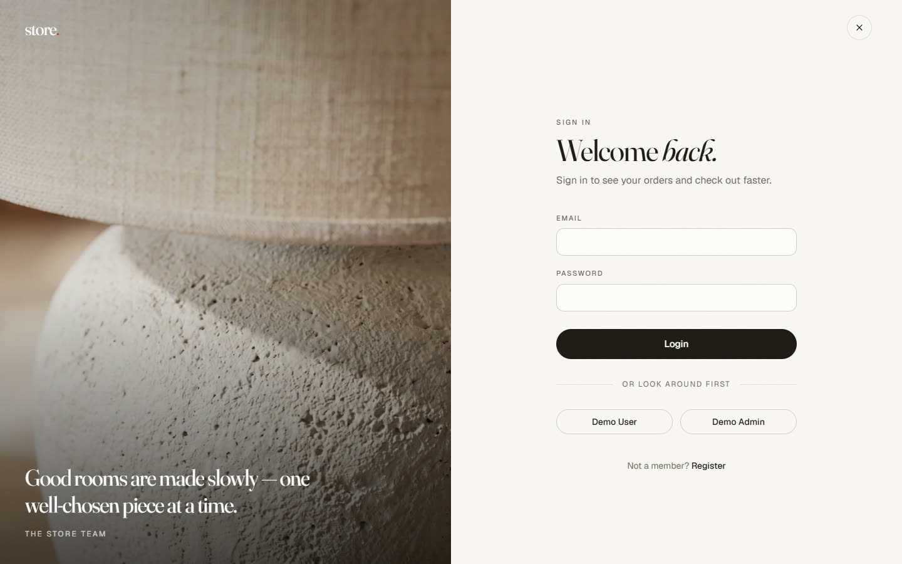
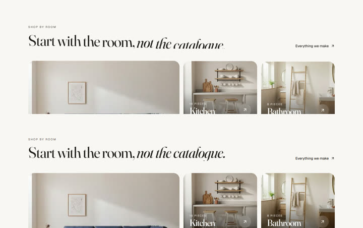
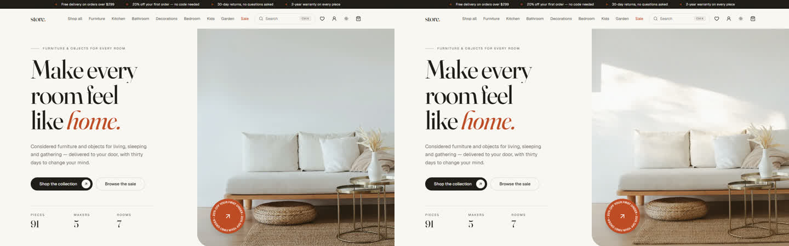
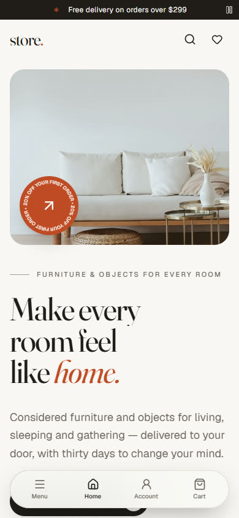
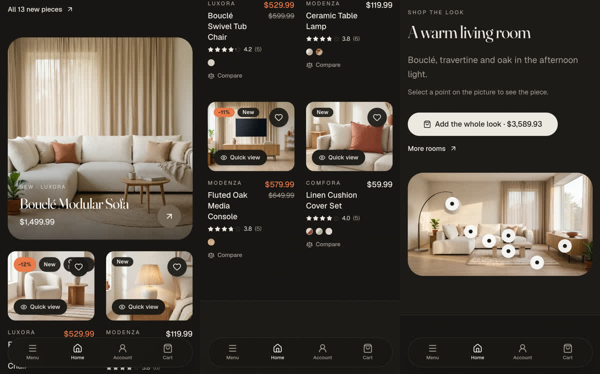
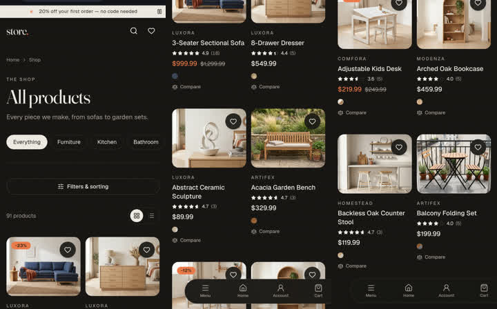
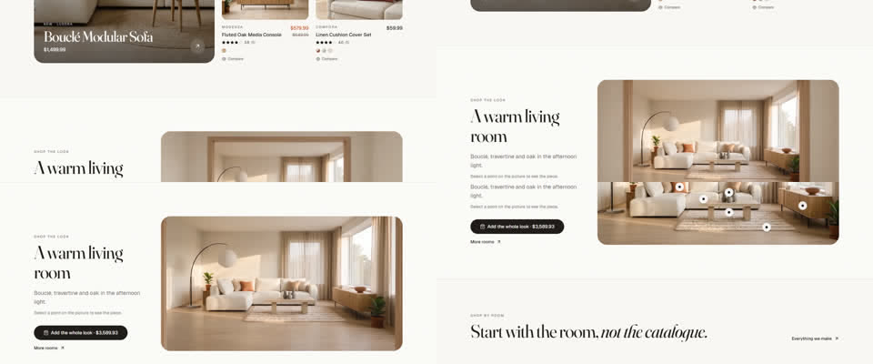

# Raport: kinowe ulepszenie sklepu

Gałąź **`feat/cinematic`** (od `main`, 6 commitów, **niepushowana**). Plan: [PLAN.md](PLAN.md),
inspiracje: [inspiration.md](inspiration.md), każda generacja: [media-log.md](media-log.md),
zrzuty: [shots/](shots/).

## Kredyty Higgsfield

| | Kredyty |
| --- | --- |
| Saldo na starcie | 1088 |
| Próg (minimum na koniec) | 400 |
| Budżet (saldo − 400) | 688 |
| **Wydane** (13 generacji: 4 obrazy, 9 wideo) | **460,5** |
| **Saldo końcowe** (`higgsfield account status`) | **627,5** |
| Zapas nad progiem | 227,5 |

| Ulepszenie | Kredyty |
| --- | --- |
| Logowanie: drzwi → sypialnia → lampa | 132 (2 obrazy, 2 szkice, finał) |
| Rejestracja: świt w pokoju z pledem | 97,75 (obraz, szkic, finał) |
| Strona główna: światło w hero | 114 (szkic, finał) |
| Strona główna: wejście do salonu w lookbooku | 116,75 (obraz, szkic, finał) |

`.claude/higgsfield-budget.log`: 13 decyzji `allow` (dokładnie te 13 generacji z logu mediów) i 2 `deny`
(komendy `higgsfield website`, zablokowane zgodnie z briefem). Nic nie zostało zablokowane przez próg.

**Lekcja kosztowa:** finał liczony ze szkicu (`--draft_job_id`) renderuje się w pełnym 1080p bez względu na
`--resolution`. Pętla do hero kosztowała przez to 96 zamiast planowanych 42. Koszt trzeba sprawdzać
komendą `generate cost` z tym samym `--draft_job_id`.

## Co zrobione

Każdy efekt ma przełącznik w **`UI/store-app.UI/src/lib/motion.ts`** (`motionFlags`). `false` przywraca
zdjęcie albo zwykły tekst. Przy `prefers-reduced-motion` wszystkie efekty są wyłączone niezależnie od
przełączników i żadne wideo się nie pobiera.

### 1. Wejście do domu na logowaniu, świt na rejestracji (`authFilm`)

- **Logowanie:** drzwi same się otwierają, kamera przechodzi przez próg do sypialni i zatrzymuje się na
  komodzie z kamionkową lampą. Potem „dojeżdża” w kodzie: ostatnia klatka powiększa się do lampy, a w tym
  miejscu wchodzi dotychczasowe zbliżenie `sign-in.webp`. Cytat wjeżdża słowo po słowie dopiero, gdy
  obraz się ustali.
- **Rejestracja:** ten sam pokój z lnianym pledem w niebieskiej godzinie wypełnia się porannym słońcem.
  Kamera stoi, a na końcu następuje dojazd do `register.webp`.
- **Bezpieczeństwo towaru:** oba klipy kończą się na prawdziwych zdjęciach produktów
  (`StonewareDrumTableLamp-1`, `StonewashedLinenThrow-1`). Generowany był tylko początek (puste wejście,
  światło przed świtem).
- **Kiedy gra:** raz na kartę przeglądarki (kolejna wizyta otwiera się od razu na zdjęciu), tylko od `lg`,
  gdzie panel ze zdjęciem jest widoczny, i nie przy Data Saver. Zablokowany autoplay albo błąd kończy się
  na zdjęciu.
- **Waga:** 1,1 MB i 0,76 MB (H.264, bez dźwięku, `+faststart`). Ekranów logowania Lighthouse nie mierzy.

Telefon (390 px) i reduced motion bez zmian względem `main`: sam formularz albo od razu zdjęcie.
Zrzuty: [mobile](shots/01-login-mobile-390.jpg), [reduced motion](shots/01-login-reduced-motion.jpg).

### 2. Nagłówki wjeżdżające słowo po słowie (`splitHeadlines`)

- **Komponent:** własny `SplitText` (bez GSAP).
- **Gdzie:** tytuły stron (`SectionTitle`), nagłówki sekcji strony głównej i cytat na logowaniu.
- **Szczegóły:** `<em>` zostaje wokół swoich słów, a czytnik ekranu słyszy zdanie raz, w całości.

### 3. Płynne przewijanie Lenis (`smoothScroll`)

- **Dla kogo:** tylko mysz i trackpad. Ekrany dotykowe zostają przy natywnym scrollu.
- **Ładowanie:** biblioteka (5,4 kB gzip) dociąga się po starcie strony i nie ma jej w bundlu głównym.
- **Dialogi:** przy otwartym oknie (Radix ustawia `data-scroll-locked` na `<body>`) Lenis staje. Bez tego
  strona pod oknem wyszukiwania przewijała się kółkiem myszy, co znalazł test.

### 4. Strona główna: hero ze światłem i spokojny pasek ogłoszeń (`heroLight`)

- **Nowe hero:** obietnica sklepu w kolumnie strony, a salon na prawej połowie, do krawędzi ekranu i na
  wysokość pierwszego ekranu.
- **Pętla światła:** 6 s, odtwarzana w tempie 0,7, start i koniec to to samo zdjęcie. Plama słońca
  z cieniem liści przechodzi po ścianie i wraca, a meble stoją.
- **Kiedy się ładuje:** wideo (0,5 MB) pobiera się dopiero po pierwszym scrollu, ruchu myszy, dotyku albo
  klawiszu, tylko na dużym ekranie. Lighthouse i roboty go nie widzą, a LCP zostaje obrazem.
- **Usunięte gadżety:** bujająca się miniatura (asset `hero2.webp` usunięty), obracający się tekst
  odznaki (odznaka zostaje, ale stoi) oraz przesuwający się pasek ogłoszeń. Komponent `Marquee`
  usunięty, bo nie miał innych użytkowników.
- **Pasek ogłoszeń:** na desktopie wszystkie 4 hasła stoją obok siebie, a na telefonie zmieniają się co
  5 s z przyciskiem pauzy (wymóg WCAG dla treści zmieniającej się sama).
- **Telefon:** zdjęcie salonu jest teraz nad nagłówkiem, żeby pierwszy ekran pokazywał meble, a nie sam
  tekst.

### 5. Przegląd na emulatorze Androida i karty produktów na telefon

Przegląd na Pixelu (Chrome 133, 412 px, motyw ciemny), na buildzie produkcyjnym przez `adb reverse`.

- **Katalog:** na telefonie dwie kolumny zamiast jednej (91 produktów to było bardzo długie przewijanie).
- **Plakietki:** sale, new i stan nie wchodzą już pod serce i zawijają się.
- **Cena:** na wąskiej karcie stoi pod nazwą, więc nazwa nie łamie się na trzy linie.
- **„Quick view”:** poniżej `sm` znika, a dotknięcie karty otwiera stronę produktu.
- **Bez zmian:** menu, koszyk, strona produktu, „O nas”, stopka i dolny dok wyglądały dobrze.

### 6. Wejście do salonu w lookbooku (`lookbookEntrance`)

- **Co widać:** sekcja „Shop the look” zaczyna się widokiem z korytarza przez dębową futrynę. Przewijanie
  wprowadza kamerę do salonu (scroll-scrub), a przewijanie w górę ją wycofuje.
- **Przejście w zdjęcie:** ostatnia klatka to prawdziwe zdjęcie lookbooka w tych samych proporcjach
  (1440×804), więc klip znika bez skoku i zostawia zdjęcie z punktami produktów.
- **Klawiatura:** fokus wewnątrz od razu odsłania punkty.
- **Ładowanie:** wideo (1,4 MB, klatka kluczowa co 6) pobiera się, gdy sekcja jest pół ekranu przed
  widokiem, tylko na desktopie.
- **Bez `blob:`:** to zwykłe źródło wideo, bo CSP sklepu nie wpuszcza `blob:` w media, a infrastruktury
  nie ruszałem.
- **Przypisanie:** klipy są przypisane do lookbooków po slugu w `src/content/lookFilms.ts`. Inny lookbook
  na pierwszym miejscu pokaże po prostu samo zdjęcie.

## Jak wyłączyć

| Efekt | Przełącznik w `src/lib/motion.ts` | Co zostaje |
| --- | --- | --- |
| Film na logowaniu i rejestracji | `authFilm: false` | zdjęcie z dotychczasowym zoomem |
| Słowa w nagłówkach | `splitHeadlines: false` | zwykły tekst |
| Lenis | `smoothScroll: false` | natywny scroll |
| Światło w hero | `heroLight: false` | samo zdjęcie |
| Wejście do lookbooka | `lookbookEntrance: false` | zdjęcie z punktami |

Zmiany układu (hero, pasek ogłoszeń, karty na telefonie) nie mają przełączników, bo to zwykły kod.
Cofnięcie: `git revert` odpowiedniego commita (`8e59a72` hero i pasek, `0c67494` karty).

## Kontrole

| Kontrola | Wynik |
| --- | --- |
| `npm run lint` | czysto |
| `npm test` | 187/187 (wcześniej 183; nowe testy: AuthFilm, SplitText, HeroLight, ScrollFilm, nowy test paska ogłoszeń) |
| `npm run build` | OK |
| `npm run check:bundle` | bundle główny 423 kB z 500 kB |
| e2e (stos z docker compose) | 28/28: wszystkie specyfikacje na serwerze Vite, a SEO (robots.txt, sitemapy) na przebudowanym kontenerze `ui`; test 17 (płatność 4242) za pierwszym razem nie zobaczył jeszcze statusu „Paid” na liście zamówień (wyścig z webhookiem, ekranu nie zmieniałem), przy powtórce 6/6 zielone |
| `npm run test:visual` (w obrazie Playwrighta) | 40/40, **żaden snapshot nie wymagał aktualizacji** |
| Lighthouse (`lighthouserc.cjs`, docker, 3 przebiegi, mediana) | wszystkie asercje zaliczone, szczegóły niżej |

| Strona | Perf | LCP | CLS | TBT | Łącznie |
| --- | --- | --- | --- | --- | --- |
| `/` | 0,98 | 1,04 s | 0 | 12 ms | 794 KB |
| `/products` | 0,98 | 1,11 s | 0 | 0 ms | 660 KB |
| `/products/83` | 0,98 | 1,09 s | 0 | 2 ms | 674 KB |
| `/journal/caring-for-oak` | 0,98 | 0,97 s | 0 | 0 ms | 751 KB |
| `/about` | 0,99 | 0,97 s | 0 | 0 ms | 602 KB |

Żadne wideo nie trafiło do pomiaru strony głównej, bo Lighthouse nie przewija i nie rusza myszą. LCP to
nadal zdjęcie hero.

## Co nie wyszło i uwagi

- **Pierwszy szkic logowania** (z końcem na `sign-in.webp`) miał przenikanie zamiast ruchu i wymyślone
  meble. Rozwiązanie: koniec na prawdziwym zdjęciu wnętrza, a przejście w detal zrobione w kodzie.
- **Hero droższe niż w planie** (96 zamiast 42), patrz lekcja kosztowa. Mimo to całość zmieściła się
  w budżecie z zapasem 227,5 kredytu.
- **Hook budżetu** w 10 z 13 wywołań nie odczytał kosztu z `generate cost` i przyjął zastępcze 150
  kredytów. To bezpieczne, bo przeszacowuje, ale blisko progu mógłby blokować zbyt wcześnie. Warto
  sprawdzić parser w `Scripts/claude/higgsfield-budget-guard.mjs` dla komend z `cd … &&` i ścieżkami.
- **Lokalny `.env.production`** wpisuje do buildu adres API z Azure. Do podglądu na emulatorze budowałem
  w trybie `--mode compose`, a kontener `ui` przebudowałem z tej gałęzi (`docker compose build ui`).
- **H.264** odtwarzają Chrome, Edge, Safari i Firefox. Wariantu WebM nie dodawałem.
- **Nieskomitowane, celowo:** `docs/cinematic/BRIEF.md` i `docs/image-prompts.md` (pliki właściciela),
  `.claude/` (w tym `launch.json` z nową konfiguracją `ui-preview` na 127.0.0.1:4173, przydatną dla
  emulatora) oraz `UI/store-app.UI/media-work/` (surowe media i zrzuty, w `.gitignore`).

## Co dalej (propozycje)

1. **Lookbooki:** klip dla kolejnych lookbooków (sypialnia, kuchnia), każdy ok. 117 kredytów i na tej
   samej zasadzie (start z korytarza, koniec na zdjęciu). Na to starczy obecny zapas.
2. **Przejścia między stronami:** View Transitions między kategoriami/pokojami, np. łagodne przenikanie
   kafla pokoju w nagłówek kategorii (0 kredytów).
3. **Wariant mobilny filmów:** lżejsze kodowanie 720p dla tabletów w pionie, które teraz dostają tylko
   zdjęcie.
